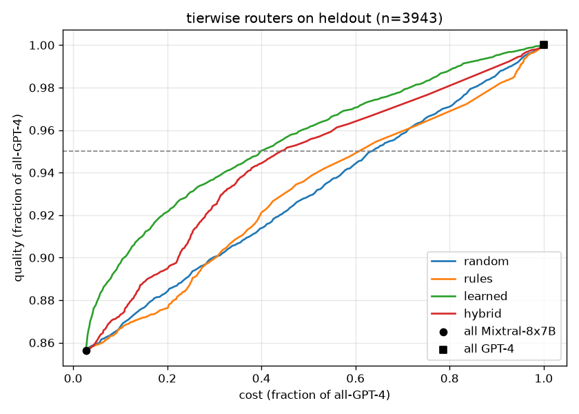
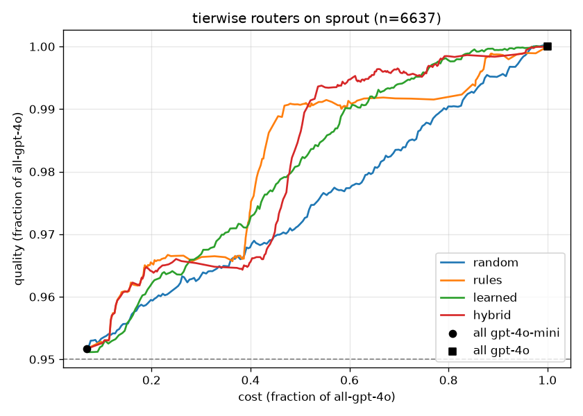

# tierwise routing benchmark

**Headline:** on 3,943 held-out prompts, tierwise's deployed router keeps **95% of GPT-4's quality at 44% of its cost (56.0% saved)**. Random routing saves 36.6% at the same quality. The learned classifier on its own saves 60.0%; the deployed router gives up 4 points of that so that rules can still push hard prompts upward.

Every number here comes from precomputed answers, so reproducing it costs nothing in API calls.

## Setup

Each prompt has an answer from a **cheap** and a **strong** model, with a known quality and cost for each. Every router gives each prompt a score, and a prompt goes to the strong model when its score is at or above a threshold *t*. Sweeping *t* from "everything cheap" to "everything strong" traces the router's cost/quality curve.

| | Held-out (headline) | SPROUT (out-of-distribution) |
|---|---|---|
| **Data** | Test split of [`routellm/gpt4_dataset`](https://huggingface.co/datasets/routellm/gpt4_dataset) (Apache-2.0). Split by prompt hash, never trained on. | Test split of [`CARROT-LLM-Routing/SPROUT`](https://huggingface.co/datasets/CARROT-LLM-Routing/SPROUT). **No license is stated**; it is downloaded at eval time, nothing from it is committed, and only aggregates are reported. |
| **Prompts** | 3,943 | 6,637 (0 dropped) |
| **Cheap / strong** | Mixtral-8x7B / GPT-4 (`gpt-4-1106-preview`) | gpt-4o-mini / gpt-4o (`2024-08-06`) |
| **Quality** | Cheap: GPT-4 judge's grade of Mixtral's answer, (score − 1) / 4. Strong: 1.0. **Assumption:** the judge graded only Mixtral, so GPT-4's own answer is the reference. | The dataset's per-model `score` in [0, 1], from an LLM judge, for both models. |
| **Cost** | Prompt and answer length ÷ 4 chars per token × list price | The dataset's token counts × list price |
| **Prices** (USD / 1M tokens, in / out) | GPT-4 10 / 30 (OpenAI); Mixtral 0.60 / 0.60 (Together AI) | gpt-4o 2.50 / 10; gpt-4o-mini 0.15 / 0.60 (OpenAI) |

**The routers:**
- **random:** a uniform random score, seed 0.
- **rules:** the M3 rules scorer.
- **learned:** the M4 classifier's raw P(strong model needed).
- **hybrid:** what the gateway actually runs: `route()` with rules first, the learned router when rules are unsure, and difficulty = max(rules, learned).

**Metrics:**
- **Cost saved at X%:** the share of the all-strong cost saved at the cheapest point that reaches X% of all-strong quality. It is interpolated between neighbouring thresholds, which in practice means randomly mixing two thresholds. *Single threshold* is the conservative version: one fixed threshold.
- **Misroutes:** prompts the cheap model failed (quality < 0.5) while the strong one didn't, that were still routed cheap at the single-threshold 95% point.
- **AUC:** the area under quality-fraction over cost-fraction.

## Results

### Held-out: Mixtral-8x7B vs GPT-4



| Router | Saved @ 95% | @ 98% | @ 99% | Single threshold @ 95% | Misroutes @ 95% | AUC |
|---|---|---|---|---|---|---|
| random | 36.6% | 14.9% | 7.0% | 36.6% | 110 | 0.905 |
| rules | 38.9% | 10.1% | 5.1% | 38.3% | 98 | 0.905 |
| learned | **60.0%** | **28.3%** | **18.0%** | 60.0% | 68 | 0.930 |
| **hybrid (deployed)** | **56.0%** | 20.2% | 9.4% | 55.9% | 73 | 0.920 |

All-Mixtral already reaches 85.6% of GPT-4's quality at 2.7% of its cost.

### SPROUT: gpt-4o-mini vs gpt-4o



| Router | Saved @ 95% | @ 98% | @ 99% | AUC |
|---|---|---|---|---|
| random | 93.2% | 35.2% | 21.0% | 0.909 |
| rules | 93.2% | **58.5%** | **53.4%** | 0.915 |
| learned | 93.2% | 51.7% | 40.9% | 0.914 |
| hybrid (deployed) | 93.2% | 52.0% | 48.8% | 0.915 |

**gpt-4o-mini alone reaches 95.2% of gpt-4o's quality** (mean judged score 0.807 vs 0.848) at 6.8% of its cost, so every router "saves" 93.2% at the 95% target just by sending everything cheap. The stricter targets are where the routers differ:
- **All routers beat random.**
- **Rules beat the learned classifier out of distribution.** The classifier learned which prompts *Mixtral* struggles with, in 2024-era data; gpt-4o-mini fails on different prompts.
- **The hybrid's recovery depends on the target.** Because rules can raise its difficulty, at 99% it recovers most of the gap between learned and rules (48.8% vs 40.9% and 53.4%). At 98% it recovers almost none of it (52.0% vs 51.7% and 58.5%).

## The deployed hybrid

- **Who decides:** the rules router decides alone only when it is confident (confidence ≥ 0.8). On every other prompt the learned classifier decides, and rules can only raise its difficulty.
- **The max rule:** this was added in M5 after the critical-set gate caught the classifier sending 4 of 10 labeled hard prompts (a proof, a derivation, an architecture design and a legal review) to basic-tier models. The rule costs 4 points on the held-out headline (60.0% → 56.0%), and it brings the out-of-distribution result closer to the rules router.
- **Low confidence:** 42.0% of held-out prompts (61.6% on SPROUT) get a decision with confidence below 0.3, so the gateway raises their quality bar one step. That comes from `to_decision` measuring distance from a low threshold (0.15) in probability space. It is a deliberate upward bias, and the next thing to tune when real traffic exists.

## Limitations

- **Older model pairs.** Neither dataset contains tierwise's registry models (Claude 5.5, GPT-5.x, Gemini 3). The benchmark measures how well the router *ranks* prompts by how much they need a strong model, and that ranking is what carries over. The registry's `quality` values stay uncalibrated placeholders until M9's shadow labels exist for current models.
- **Two models, single-turn.** The gateway chooses among many models and caches multi-turn prefixes, and neither shows up here. Cache-aware selection is covered by the M3 tests instead.
- **Judge-based quality.** Both datasets grade answers with an LLM judge, and the held-out set assumes GPT-4's answer is always right.
- **SPROUT's license is unstated.** It is used for aggregate numbers only.

## Reproduce

```bash
uv sync --group train
uv run python -m training.export_onnx
uv run python -m training.prepare_data --limit 40000
uv run python -m evaluation.run_eval --dataset heldout   # docs/benchmark/heldout.{json,png}
uv run python -m evaluation.run_eval --dataset sprout    # downloads ~580 MB into the HF cache
```

The critical-set gate (`tests/evaluation/test_critical_gate.py`) checks that the 10 labeled hard prompts never route to a basic-tier model. Coverage differs by environment:
- **CI** runs the rules path only, because the 90 MB ONNX encoder isn't there. The max(rules, learned) logic is covered separately by unit tests with fake routers.
- **The learned path**, with the trained classifier, runs wherever the model files exist. Run it after every retrain.
