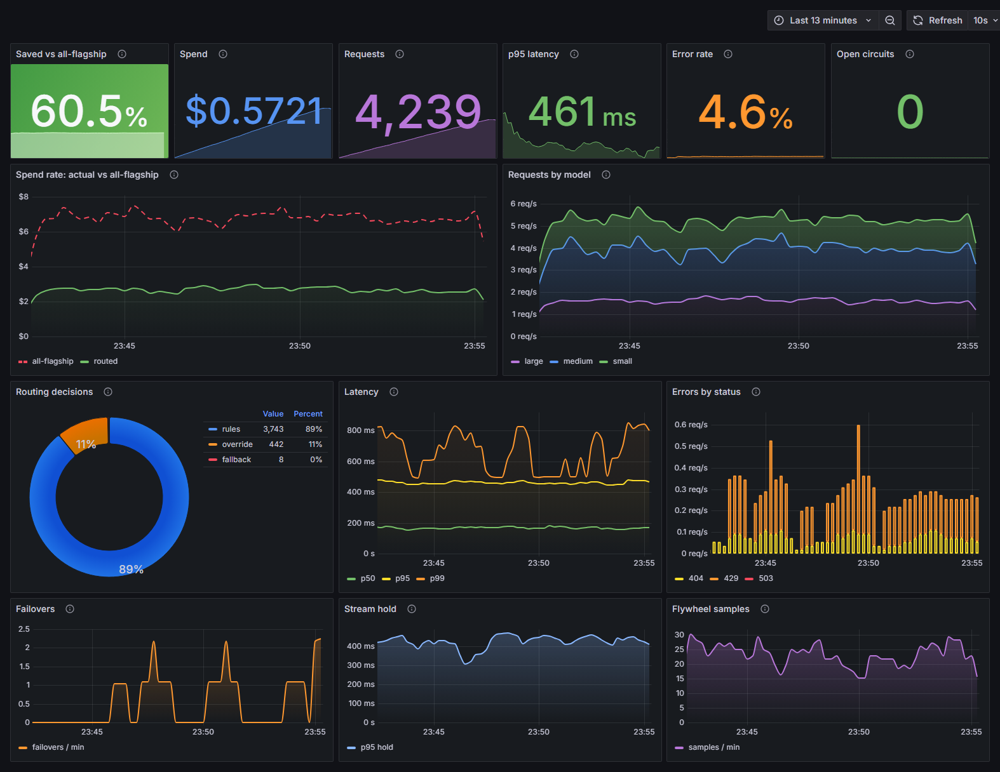

# tierwise

[](https://github.com/Suryanshu-77/tierwise/actions/workflows/ci.yml)
[](https://pypi.org/project/tierwise/)
[](https://pypi.org/project/tierwise/)
[](LICENSE)

A self-hosted, OpenAI-compatible LLM gateway that picks the cheapest model expected to answer
each request well, across Anthropic, OpenAI, Gemini and local Ollama models, and measures whether
that choice paid off. Point any OpenAI SDK client at it by changing `base_url`.

- **Benchmark:** on 3,943 held-out prompts, tierwise's router keeps 95% of GPT-4's quality at
  44% of its cost (random routing: 63%).
- **Data flywheel:** in a $0 local run, about 400 labels from a free 7B judge raised the cost
  saved at 99% quality by 10 points. The router retrains on your own traffic, behind a
  champion/challenger gate.
- **Method, out-of-distribution results and limitations:** [BENCHMARK.md](BENCHMARK.md).



**Status:** 0.9.2 (beta). Learned routing, retries and failover, per-key budgets and rate
limits, Prometheus/Grafana/OpenTelemetry, and a data flywheel that retrains the router on your
own traffic. See [CHANGELOG.md](CHANGELOG.md) and the [design document](docs/design.md).

## How a request flows

```
client (OpenAI SDK)
  -> auth (Bearer tw-...) -> rate limit (token bucket)
  -> route(): override tag | rules scorer | learned router  => difficulty
  -> semantic cache lookup (opt-in)
  -> select(): cheapest (model, effort) that clears the quality bar, cache-aware
  -> budget reserve -> serve(): retries, circuit breakers, failover (up to 3 models)
  -> settle actual cost -> request log, metrics, traces
```

## Quickstart

```bash
pip install tierwise        # or run it without installing: uvx tierwise
tierwise fetch-model        # optional: the 90 MB encoder for the learned router
export ANTHROPIC_API_KEY=…  # any of the provider keys below (or put them in .env)
tierwise                    # serves http://127.0.0.1:8000
```

The default model registry ships with the package. Point `TIERWISE_REGISTRY` at your own copy
to change models or prices. From a checkout, use `uv sync` and then `uv run tierwise`; the repo's
`config/` and `models/router` take precedence over the packaged copies.

Use it from any OpenAI SDK client by changing the base URL:

```python
from openai import OpenAI

client = OpenAI(base_url="http://127.0.0.1:8000/v1", api_key="unused")
reply = client.chat.completions.create(
    model="auto",              # let tierwise choose; or any id from config/registry.yaml
    messages=[{"role": "user", "content": "Hello"}],
    stream=False,              # stream=True works too
)
```

`GET /v1/models` lists the models whose provider is configured. Each response carries
`X-Tierwise-Model`, `X-Tierwise-Provider`, `X-Tierwise-Reason` and `X-Tierwise-Request-Id`
headers, plus `X-Tierwise-Cost-USD` on non-streamed replies.

## Automatic routing

Send one of these as `model` and tierwise picks the model for you:

| `model` | What happens |
|---|---|
| `auto` (default) | score the request's difficulty, pick the cheapest model good enough for it |
| `auto:cheap` / `auto:quality` | same, with the quality bar lowered or raised one notch |
| `tier:basic` / `tier:moderate` / `tier:flagship` | cheapest capable model in that tier, no scoring |
| a registry id, e.g. `claude-sonnet-5-5` | exactly that model |

Put `[critical]` or `[easy]` anywhere in your last message to force the hardest or easiest
routing; the tag is removed before the request is forwarded.

How a model is chosen:

1. **Difficulty.** `src/tierwise/router/rules.py` scores the request from cheap signals: length,
   code, math, high-stakes words ("production", "security"), reasoning words ("design",
   "prove"), easy words ("translate", "hi"), tools, images and conversation length. When the
   rules aren't sure, the [learned router](#learned-router) decides instead.
2. **Quality bar.** `bar = 0.30 + 0.65 x difficulty`, shifted by `auto:cheap`/`auto:quality`,
   and raised one step when the scorer is unsure (a score near 0.5).
3. **Selection.** Models that lack a needed capability (tools, vision, JSON) or context window
   are dropped. Of those that clear the bar, the one with the lowest *estimated* cost wins,
   counting prompt-cache discounts. A 422 `no_eligible_model` means nothing could handle it.
4. **Affinity.** Conversations stick to the model whose prompt cache is still warm, unless
   switching would save more than 10%.

### Reasoning effort

Thinking tokens are billed as output, so tierwise picks a **model and an effort level
together**: each model with an `efforts` block in the registry becomes one option per level,
and the cheapest option that still clears the quality bar wins.

- **Scale:** `minimal`, `low`, `medium`, `high`, `xhigh`, `max`. Sent to Anthropic as
  `output_config.effort`, to OpenAI as `reasoning_effort`, and to Gemini as
  `thinkingConfig.thinkingLevel`. When the chosen level is the provider's default, nothing
  is sent.
- **Quality:** a level below the default lowers quality by its registry value at difficulty
  0.5, scaled with the request's difficulty: low effort costs little on easy requests and a
  lot on hard ones.
- **Caching:** `effort_in_cache_key: true` (Anthropic) means a different effort can't reuse
  the conversation's prompt cache, so tierwise prices that switch as a cache miss.
- **Your effort wins:** send `reasoning_effort` and tierwise only considers models that
  support that level (422 `no_eligible_model` if none do).
- `X-Tierwise-Effort` reports the level sent, or `default`; `scripts/costs.py` breaks cost
  down by effort.

`X-Tierwise-Reason` says why: `rules` (scored), `learned` (the classifier decided), `override`
(tag, tier or explicit model), `affinity` (kept on its warm model) or `fallback` (router error,
or no model cleared the bar).
Retune the scorer by editing `WEIGHTS` in `rules.py` and running
`uv run pytest tests/router/test_rules.py`, which checks it against 30 labeled prompts.

### Learned router

The rules router decides alone only when it is confident (confidence of 0.8 or more, about 1.5%
of real prompts); everywhere else a trained classifier decides, and the rules can only raise its
difficulty, never lower it. It embeds the last two user turns and the head of the system prompt (at most 256
tokens) with MiniLM on ONNX Runtime, and a small classifier head predicts P(a cheap model's
answer won't be good enough). Inference runs in a two-thread pool, never on the event loop.

It is trained on [`routellm/gpt4_dataset`](https://huggingface.co/datasets/routellm/gpt4_dataset)
(Apache-2.0): prompts whose Mixtral answer a GPT-4 judge graded below 4 of 5 are labeled
"needs a strong model". Held-out results (`models/router/metrics.json`):

| | Test ROC-AUC |
|---|---|
| Rules router | 0.589 |
| Learned router (MiniLM + MLP) | **0.735** |

Trained on 32k prompts, 13% of which needed a strong model. Validation picked the MLP over
logistic regression (0.745 vs 0.731 ROC-AUC) and a decision threshold of 0.15. On CPU the
encoder plus classifier takes 6.3 ms at p50 (`scripts/bench_router.py`).

The tokenizer and trained classifier are committed and ship in the wheel; the 90 MB ONNX encoder
does not. Without it the gateway logs a warning and routes with rules only. Fetch it with
`tierwise fetch-model`, which downloads the official Hugging Face export at a pinned commit and
checks its sha256 before saving it to `~/.cache/tierwise/router/`, where the gateway finds it
on its own. The gateway looks for `model.onnx` in the router directory first, then in that
cache. Only use `--out DIR` with `TIERWISE_ROUTER_DIR=DIR` if `DIR` also holds `router.json`,
`classifier.npz` and `tokenizer.json`. Otherwise the learned router turns itself off.

To export it yourself, or to retrain:

```bash
uv sync --group train
uv run python -m training.export_onnx             # models/router/model.onnx
uv run python -m training.prepare_data --limit 40000
uv run python -m training.train                   # classifier.npz, router.json, metrics.json
uv run python scripts/bench_router.py             # p50 latency, budget 10 ms
```

Set `TIERWISE_LEARNED_ROUTER=false` to turn it off; `TIERWISE_ROUTER_DIR` points elsewhere.

## Keys, budgets and rate limits

Give each team or app its own key, with a monthly spending cap and a request rate:

```bash
tierwise keys create --name analytics --budget 50 --rpm 60   # prints the key once
tierwise keys list                                           # spend this month, no secrets
tierwise keys revoke 3f9c2a1b7d4e
```

Clients send the key the way they would an OpenAI key:

```python
client = OpenAI(base_url="http://localhost:8000/v1", api_key="tw-...")
```

- **Keys** are stored only as SHA-256 hashes. Set `TIERWISE_REQUIRE_KEY=true` to reject
  requests without a valid key (401 `invalid_api_key`). Even with that off, a valid key is
  still used, so its spend is tracked. The gateway picks up keys created or revoked by the
  CLI within 30 s.
- **Rate limit:** a token bucket per key. A key can burst up to its `--rpm`, then gets
  `--rpm` requests per minute. Beyond that the response is 429 `rate_limited` with a
  `Retry-After` header.
- **Budget:** per UTC calendar month.
  - **Before calling a model,** the request reserves its estimated cost. A reservation that
    would exceed the budget gets 429 `budget_exceeded`. That stops a burst of concurrent
    requests from all passing a check before any of them is charged.
  - **Reservations are estimates.** Without `max_tokens`, the output is estimated at 512
    tokens, so a key can end the month over its budget by the real cost of the requests
    already in flight. Set `max_tokens` to make the cap tight.
  - **Enforcement:** budgets and rate limits are enforced only with
    `TIERWISE_REQUIRE_KEY=true`. Otherwise a client can drop its key and be served
    anonymously.
  - **After the call,** the actual cost is charged and the reservation is released. Failed
    requests cost nothing, and cache hits cost $0.
  - **Persistence:** spend lives in memory and is written to the `usage_monthly` table
    without ever being dropped. A failed database write is retried, and shutdown waits for
    it.

## Reliability

A request survives a failing model or provider:

- **Retry.** Up to 2 retries on the same model for rate limits, 5xx and timeouts, with
  exponential backoff and full jitter. Bad requests (4xx) and rejected credentials are never
  retried.
- **Failover.** Then the selector's next candidate is tried, up to 3 models per request.
  - **Provider-wide failures:** after a connection failure or an auth error, the rest of that
    provider's models are skipped.
  - **Model failures:** after a model fails, other providers are tried before its siblings.
  - **Bad requests** are never failed over.
  - `X-Tierwise-Failovers` and the log's `failover_count` say how many candidates were
    abandoned. A named model (`"model": "claude-sonnet-5-5"`) is retried but never swapped.
- **Circuit breakers** run at two levels:
  - **Per (provider, model):** trips on 429, 5xx and timeouts, so a rate-limited Opus
    doesn't block Haiku.
  - **Per provider:** trips on connection failures and auth errors, or when 2 of its models
    are open.
  - **Timing:** 5 consecutive failures within 60 s open a breaker. After a 30 s cooldown, a
    single probe request decides whether it closes again. When every candidate is open, the
    gateway answers 503 `upstream_unavailable`.
- **Streams fail over too.** Nothing is sent to the client, not even the 200, until the first
  real content arrives (capped at 3 s or 4 KB). An upstream that dies before that is replaced
  without the client noticing. After that point, a failure ends the stream with an
  OpenAI-style error event.

## Semantic cache

A repeated question is answered without calling a model (`X-Tierwise-Reason: cache`). The
log records it with cost 0 and the full baseline cost, so it counts toward savings.

- **What has to match:**
  - **The last user message**, by meaning: MiniLM embeddings with cosine similarity of at
    least 0.95. A message over 256 tokens must match exactly.
  - **Everything else**, exactly: the system prompt, earlier turns, the routing mode and tag,
    and `response_format`.
- **Skipped when:**
  - `temperature` is above 0.3 or unset (unset means the provider default, 1.0).
  - Tools or images are present.
  - The client sends `Cache-Control: no-cache`.
  - The model is named explicitly.
- **Lifetime:** entries live for an hour in memory (10 000 at most, oldest out first). Only
  complete text answers are stored.
- **Threshold:** 0.95 is deliberately strict. "What's the capital of France?" and "What is
  the capital of France?" score 0.91 and miss, while two phrasings of a coding question
  score 0.98 and hit. Lower `CACHE_SIMILARITY` for more hits at more risk.
- **Off by default.** Turn it on with `TIERWISE_CACHE=true`. It also needs the learned
  router's ONNX encoder.
- **Known limit:** sentence embeddings barely register negation or direction. "Is it safe to
  mix bleach and ammonia?" and "Is it unsafe…" score 0.99; "Convert 100 USD to EUR" and
  "EUR to USD" score 0.98. Only enable the cache for traffic where such near-duplicates
  really do share an answer, such as FAQ bots or repeated batch prompts.
- **Never matched by meaning:** text the encoder can't represent faithfully is matched
  exactly. That covers emoji, rare symbols, words over 100 characters, and anything over 256
  tokens.

## Data flywheel

The learned router was trained on someone else's traffic, so on prompts unlike that data it
does worse than it should. The flywheel collects labels from **your** traffic, without
changing anything a user receives.

**1. Sample (in the gateway, free).** A routed answer is stored in `shadow_samples` only when
all three of these opt-ins hold:

| Opt-in | How |
|---|---|
| The gateway may store payloads | `TIERWISE_STORE_PAYLOADS=true` |
| The key's owner agreed | `tierwise keys create --name team --allow-shadow` |
| The router made a choice | `model` is `auto*` (not a fixed model or tier) |

Only complete text answers are sampled; tool calls and cache hits never are.
- **Rate:** `TIERWISE_SHADOW_RATE` (default 2%), and more often when the router wasn't sure.
- **Off the request path:** samples go through the same queue as the request log, so a
  request never waits for one.
- **Metric:** `tierwise_shadow_samples_total` counts them.

**2. Label (offline, paid).** Run:

```bash
tierwise flywheel label --limit 500
```

For each sample:
1. A contrast model answers the same request. That is the flagship (`baseline_model`) if a
   cheaper model answered, otherwise the cheapest basic model.
2. A judge model (`TIERWISE_JUDGE_MODEL`, default the baseline model) sees both answers, in a
   random order, and scores the cheaper one from 1 to 5. Below 4 means the prompt **needs a
   strong model**, the same rule the original training labels used.

Each label is two paid calls. The run stops at `TIERWISE_SHADOW_BUDGET_USD` (default $5) per
calendar month, counting earlier runs. The run can go over the budget by at most one sample.
The compose stack's fake upstream answers for free; its made-up prices still count against
the budget. Its fake judge scores hard-looking prompts 2 and easy ones 5.

**Privacy:** samples store prompts and answers in your database, which is why collection
needs three opt-ins. There is no purge command yet; delete rows from `shadow_samples`
directly if you need to.

**3. Retrain and gate (offline).** Needs the encoder (`tierwise fetch-model`):

```bash
uv sync --group retrain
uv run python -m training.retrain           # add --dry-run to gate without promoting
```

1. **Train.** Labeled samples are split by prompt hash, as the original data was, so no prompt
   is in both training and test. They are merged with `training/data` if it's there, and a
   **challenger** is trained.
2. **Score.** The current router (the **champion**) and the challenger are scored on the same
   held-out rows:
   - the cost saved at a quality target set from those rows: half the gap between all-cheap
     and all-flagship quality, never below 95%, so easy traffic can't make every router tie
   - critical misroutes: the 10 labeled hard prompts in `tests/router/labeled_prompts.jsonl`
     that the deployed router would send to a basic model, counted through the gateway's own
     `route()` and `select()`
3. **Gate.** The challenger is promoted only if all of these hold:
   - the held-out set has **at least 20 rows of both labels**
   - **zero critical misroutes**. The rules can only raise difficulty, so this is a floor the
     rules guarantee.
   - its classifier alone calls **no more** hard prompts easy than the champion's does
   - it has **at least the champion's cost saved**

   On a tie, the better AUC wins, so re-running with no new labels changes nothing.
4. **Version.** Every challenger is kept, write-once, in `models/router/versions/<UTC
   timestamp>/`. Its `router.json` names its own weights. Promoting is a single atomic
   replace of the router dir's `router.json`, so weights and threshold always switch
   together. A champion that isn't in `versions/` yet is archived first, as
   `versions/initial-<hash>/`. Restart the gateway to load the new router; `/healthz` shows
   `router_version`.

To switch to any version (to roll back, or forward), copy `versions/<id>/router.json` over the
router dir's `router.json` and restart.

**With the compose stack:** the gateway image contains a copy of `models/router` taken when the
image was built. After a promotion (or a switch) on the host, rebuild it to pick up the change:
`docker compose -f deploy/docker-compose.yml up -d --build gateway`.

**Labels from the fake judge** only know a few keywords, so a challenger trained on them
usually overfits and the gate rejects it. `scripts/flywheel_e2e.py` shows exactly that, then
checks the version switch above. Real gains need a real judge model.

`scripts/flywheel_e2e.py` runs the whole loop (sample, label, retrain, gate, switch version)
against the fake upstream. CI runs it on every push.

## Run the full stack

One command starts the gateway with Postgres, Prometheus, Grafana and Jaeger, plus a fake
OpenAI-compatible model server, so it runs with no API keys and costs nothing:

```bash
docker compose -f deploy/docker-compose.yml up --build
docker compose -f deploy/docker-compose.yml exec gateway tierwise keys create --name me
```

| | URL |
|---|---|
| Gateway (OpenAI-compatible) | http://localhost:8000/v1 |
| Grafana dashboard | http://localhost:3000/d/tierwise |
| Prometheus | http://localhost:9090 |
| Jaeger traces | http://localhost:16686 |

**The dashboard** (pictured at the top) shows:
- **Headline stats:** savings against an all-flagship baseline, spend, requests, p95 latency,
  error rate and open circuits.
- **Cost:** spend per hour against what the same traffic would cost on the flagship.
- **Traffic and routing:** requests by model, and why each request went where it did (rules,
  the learned router, an override, cache affinity, the semantic cache or a fallback).
- **Reliability:** latency percentiles, errors by status, failovers and stream hold time.
- **Flywheel:** samples collected for offline labeling.

**Fill it with traffic:** `scripts/traffic.py` sends a realistic mix for a few minutes: easy
and hard prompts, streams, routing modes, overrides, multi-turn chats, unknown models and a
rate-limited key. Two knobs on the fake upstream add model latency and upstream failures, so
retries and failover have something to do:

```bash
FAKE_DELAY_S=0.05 FAKE_FAIL_RATE=0.15 docker compose -f deploy/docker-compose.yml up -d --build
uv run python scripts/traffic.py --minutes 15
```

**Behind it:**
- **Prometheus** scrapes the gateway's `/metrics` endpoint. `/metrics` has no auth, by
  Prometheus convention, so keep port 8000 off the public internet (or put a proxy in
  front of it).
- **Jaeger** receives one trace per request, with spans for routing, the cache, selection
  and each provider attempt.

**Real models:** to use them instead of the fake server, point `TIERWISE_REGISTRY` at
`config/registry.yaml` and put provider keys in `.env`.

`scripts/compose_smoke.py` checks the running stack end to end; CI runs it on every push.

**Demo:** `uv run python scripts/demo.py` sends prompts of rising difficulty through the stack
and shows what each one cost against always using the flagship:

```text
prompt                                            model   effort   reason              cost $
hi, thanks                                        small   default  rules             0.000005
What is the capital of France?                    small   default  rules             0.000005
Translate 'good morning' into Spanish.            small   default  rules             0.000005
Design a multi-tenant SaaS billing architectu...  large   default  rules             0.000385
Debug this production outage: checkout latenc...  large   default  rules             0.000365
Prove that the square root of 2 is irrational.    large   default  rules             0.000330

total $0.001095 vs $0.001995 always-large: 45% saved
```

## Providers

| Provider | Enable with | Notes |
|---|---|---|
| Anthropic | `ANTHROPIC_API_KEY` | prompt-cache reads and writes are priced separately |
| OpenAI | `OPENAI_API_KEY` | `OPENAI_BASE_URL` points it at any OpenAI-compatible host |
| Gemini | `GEMINI_API_KEY` | native API; only `data:` image URLs are accepted |
| Ollama | `OLLAMA_BASE_URL` | free local models, e.g. `http://localhost:11434/v1` |

## Model registry

Every servable model lives in [config/registry.yaml](config/registry.yaml) with its provider,
prices (USD per 1M tokens), context window and capabilities. To add a model, add an entry:

```yaml
  - id: my-model            # the name clients send
    provider: openai
    upstream_id: real-name  # optional, if the provider calls it something else
    price_in: 0.50
    price_out: 1.50
    price_cache_read: 0.05  # optional; defaults to price_in
    context: 128000
    caps: [tools, json]
    quality: 0.6
    tier: basic
```

The gateway refuses to start if the file is invalid. Verify prices against each provider's
official pricing page; the shipped values are a starting point.

## Costs and the request log

Every request is logged (SQLite by default, `TIERWISE_DB_URL`) with tokens, cost and the cost
the same tokens would have had on the baseline model. Summarize it with:

```bash
uv run python scripts/costs.py
```

Check every configured provider end to end, plain and streamed:

```bash
uv run python scripts/smoke.py
```

```bash
uv run python scripts/smoke.py --stream
```

See which model `auto` picks for an easy, a medium and a critical prompt:

```bash
uv run python scripts/smoke.py --auto
```

## Development

```bash
uv sync
uv run pytest
uv run ruff check .
uv run mypy src
```

### Releasing

Releases go to PyPI from a tag through
[Trusted Publishing](https://docs.pypi.org/trusted-publishers/), so no token is stored.

1. **Once,** on pypi.org, add a *pending publisher*:
   - project `tierwise`
   - owner `Suryanshu-77`, repository `tierwise`
   - workflow `release.yml`, environment `pypi`
2. **Once,** in the repository settings, create the `pypi` environment. Add yourself as a
   required reviewer so every publish waits for your approval.
3. **Each release:** bump `version` in `pyproject.toml`, add a `CHANGELOG.md` entry, then:

   ```bash
   git tag v0.8.0
   git push origin v0.8.0
   ```

The workflow checks that the tag matches the version, builds, smoke-tests the installed wheel
from an empty directory (`scripts/wheel_smoke.py`), then publishes.
